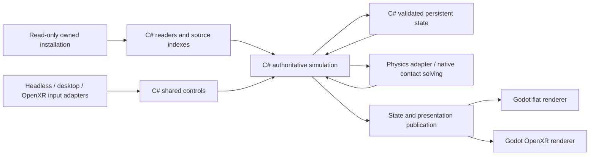

# Runtime ownership and engineering requirements

The engine must have one authoritative simulation. Headless, desktop and OpenXR
input feed the same controls, scripts, quests, world transitions and save owners.
Rendering consumes that state. A missing GPU must not prevent a gameplay tick or
make a completed simulation state unsavable.

## Dependency direction

This is the required dependency contract. The remaining implementation gaps are
listed below; the diagram does not claim they are complete.

Physics, animation and collision data needed by gameplay belong to simulation
services. Rendering may share decoded source resources, but it cannot own their
gameplay eligibility or substitute a visible mesh for an authoritative body.
Window, GPU, draw and headset handles remain process-local adapter resources.
Cold Continue reconstructs those resources around validated gameplay state.

## Start reading here

| Concern | Owner and boundary |
| --- | --- |
| Composition and launch selection | `RuntimeCoordinator` and `RuntimeLaunchValidator` admit the source. `RuntimeInputPresentationSelection` selects command/device input independently of the actual rendering backend; HDR follows that backend. |
| Shared input state | `FalloutDirectInputState` owns controls, cached samples, script edges, thread checks and native reader leases. |
| Windowless input | `FalloutHeadlessInput` accumulates complete command samples. `RuntimeNativeDirectInput` adapts host events; desktop selection instead owns `WindowsDirectInputDevice`. |
| Input layout | `FalloutInputLayout` names the fixed keyboard, mouse and wheel protocol values. Native ABI declarations retain their independent size assertions. |
| HDR source state | `FalloutSkyHdrState` consumes `IFalloutSkyHdrCapability`; it does not import Godot rendering classes. |
| HDR host lifecycle | `IRuntimeSkyHdrCapability` separates `RuntimeNativeSkyHdrCapability` from `RuntimeHeadlessSkyHdrCapability`. The headless provider owns no GPU resources and requires no render-thread callback. |
| Presentation | `RuntimeNativeImageSpace` borrows the selected capability and projects source state. Headless capability never certifies a shader draw or final pixels. |
| Source image receiver | `FalloutSourceImageSpaceReceiver` owns the shared parameter arrays, allocation scopes and ordered field writes. `FalloutHeadlessImageSpaceOutput` publishes those CPU fields without GPU resources; the rendered adapter uses the same receiver. |
| Menu image lifetime | `FalloutImageSpaceState` uses the same modifier list for Main and menu capture. The menu caller performs two updates without advancing the process clock and removes all matching form instances in one ordered linear pass. An unknown auxiliary interface gate remains visible and refuses when its live state would change the result. |
| Screen-blood effects | `FalloutScreenBlood` owns the shared settings, random geometry and menu-paused lifetime. `FalloutHeadlessScreenBlood` consumes validated source DDS bytes and observes fade/retirement without GPU resources; `NativeOwnedScreenBlood` draws the rendered output. |
| Actor model data | `FalloutActorSourceModel` gives each actual source assembly a fresh C# factory. `FalloutNifPhysicalModel` reads original ordered scene slots, wrappers, bodies and constraint registrations with indexed identity lookup and an explicit linear traversal. Authored declarations do not supply a live dynamic world. |
| Physical constructor inputs | `FalloutPhysicalConstructorInputs` consumes injected winning settings, preserves source Float32 stores and projects the capsule plus eighteen ordered convex inputs with independent radii. Canonical hulls and real shapes remain separate consumers. |
| Character collision groups | `FalloutCharacterCollisionGroups` owns the source shared counter, allocation-time truncation/reset and cold reconstruction. Allocation is O(1) on the physics owner thread. A phantom filter getter does not allocate. Production factory publication remains pending. |
| Controller position math | `FalloutCharacterControllerTransformState` reads an injected current proxy transform. It never substitutes a reference origin or Godot position for actual phantom state. |
| Trigger membership | `FalloutReferenceInstance` owns ordered logical contact membership with indexed identity lookup. Cold restore validates the complete candidate world before publication and replays no Enter. Physical contact production, source ordering and cold broadphase publication remain separate missing owners. |
| Selected sound namespace | `FalloutSoundSearchNamespace` resolves the selected read-only DATA layers while retaining direct-before-prefix startup lookup and a separate installation auxiliary file. Source archive registration and cold identity use those winning original bytes. Merged native loose-directory enumeration remains unowned. |
| Compiled event dispatch | `FalloutCompiledScriptProgram` indexes actual event identity and ordered instruction slices once in linear time. Dispatch uses constant-time membership/slice lookup and preserves source execution order and failures. |
| Package callbacks | Compiled Start, Done and Change callbacks preserve winning PACK filters, actual actor callers, source event order and current/cold failed prefixes. Dynamic SCRV package references still require their separate producer. |
| PCM continuation admission | `NativeOwnedAnimationSoundPlayer` observes actual mixer health before emitter eligibility. An unsupported emitter retains its exact negative capability without losing state publication; corruption propagates and complete saving still refuses missing continuation identity. |
| Source sound emitters | Raw KF and typed NIF declarations share one emitter/StopSounds dispatcher. Bone and static-node cold identities bind original source hashes and block identities to fresh adapters; anonymous Godot names are not save identities. Source-disabled and independent ANIO lifetimes retain separate refusals. |
| Native mod discovery | `RuntimeLiveContentSource` selects FOSE or NVSE directories by edition. Source failure remains part of the selected module graph; discovering a module does not supply its missing host ABI or execution owner. |
| Headless native imports | Native import binding validates the original provider and signature. `NativePluginHeadlessUser32` owns the actual product thread and SDK keyboard layout/conversion calls; reached operations requiring a window or a Win32 message-queue keyboard producer still refuse. |
| Native Logging | The selected xNVSE ABI exposes its actual readonly fastcall table and original ANSI configuration bytes. Declared diagnostic writes map to private output with module/thread/lifetime receipts; this does not supply other missing native interfaces or gameplay functions. |
| Selected CRT functions | Six source-selected string/conversion/math imports retain the genuine x86 provider and original IAT pointer. Binding verifies the original file, executable export and mapped coordinate; ST0 and XMM0 ABIs never pass through managed math substitutes. CRT thread error/floating cold state remains a separate save requirement. |
| Persistence | Completed authoritative state is validated before publication. `RuntimeAtomicSaveFile` owns bounded filesystem publication; it never replays gameplay effects. |
| Live diagnostic status | `RuntimeSaveRequestStatusView` and `FalloutCellProcessesSummary` read current identities, counts and every failure without copying detailed process graphs or entering save capture. Explicit detailed state retains those graphs; status is not a reusable save. |

Host selection occurs at the composition boundary. Gameplay receives an explicit
dependency, rather than discovering a renderer, window or global service while
executing a quest. Stable required dependencies belong in constructors.
Post-construction bindings are reserved for actual runtime ownership changes,
such as an attached scene or native generation; they must validate identity,
replacement, thread and retirement.

## Cost and readability

Use cohesive namespaces and names that describe the owned state or operation.
Keep failure handling adjacent to the lifecycle it protects. Comments explain
source semantics, ordering and non-obvious decisions; straightforward code should
explain itself. Share actual behavior and protocol definitions. Add an interface
when production needs interchangeable owners, rather than for a hypothetical
future extension.

Use indexed identity lookup where possible: arrays give O(1) input-key access,
and dictionaries give expected O(1) identity lookup. Input publication visits a
fixed 266-key extent, independent of the installed record count. Preserve source
ordering where it is meaningful. Required sorting may be O(k log k); avoid
repeated full-list searches inside corpus loops and document any necessary
higher-cost operation with its bounds and measurements.

Per-frame work must follow resident or changed state, with explicit work budgets
and retirement. Do not scan the entire installed corpus every tick or create
unbounded caches and diagnostics. Measure allocations, frame cost, loading and
repeated travel with representative owned data before making a performance claim.
This document does not certify the complexity of every existing owner.

Fixed binary layouts, ABI values and source flags are named constants or enums.
Player preferences and supported tuning belong in typed configuration; retail
behavior comes from the winning owned records and settings. Moving protocol
values into editable configuration would allow invalid engine contracts.

## Current implementation limits

The explicit headless route still uses Godot as its process, input and physics
host. Renderer independence does not mean that the current product has a separate
standalone simulation executable.

Actual FO3 startup reaches the Vault birth cell, then the shared Player frame
fails at its unimplemented independent Actor collision-body utility. Some model,
pose and physics publication remains coupled to native scene construction.
Those owners must be separated without bypassing source behavior. Complete
gameplay saves remain refused while the frame is unfinished. A birth-cell repeat
now reaches CG00 stage 100 through ordinary character creation and exits normally
with zero telemetry loss. Manual saving remains deferred by the incomplete source
invocation and cancellation produces no complete gameplay save. Its prior native crash remains a
diagnostic until repeatable complete-game teardown is established.

Component contracts verify adapter boundaries and cold reconstruction. They do
not establish the requested Goodsprings, Vault or Megaton routes. The current
verified result and next implementation owner live in [current-work.md](current-work.md).
